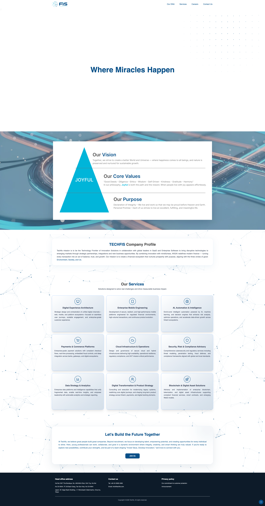

# Techfis Innovation — Corporate Web Platform

<p align="center">
  
</p>

Official repository for the [Techfis Innovation](https://techfis.com) corporate website.

Techfis Innovation (Fintech Innovation Solution JSC) is a technology company delivering digital solutions across financial technology, supply chain, and hospitality. This repository contains the source for the company's public website, which serves as the primary hub for our services, products, and company information.

---

## Overview

The website presents Techfis Innovation's core service offerings:

- **Cloud Infrastructure & Operations** — Design and management of multi-tenant cloud and hybrid environments.
- **Security, Risk & Compliance** — Cybersecurity frameworks and guidance for meeting regulatory requirements.
- **Data Strategy & Analytics** — Data infrastructure engineering and machine learning capabilities.

The banner above (`image.png`) reflects the site's primary design scheme and layout. For the latest designs and responsive component states, refer to the design team's Figma workspaces or the shared assets folder.

---

## Tech Stack

- **Framework** — Next.js / React with server-side rendering (SSR) for performance and accessibility.
- **Styling** — Tailwind CSS, mapped to the Techfis design system tokens.
- **Deployment** — Containerized builds delivered through CI/CD pipelines to a cloud environment.

---

## Getting Started

### Prerequisites

- Node.js 18.x LTS or higher
- `npm` or `yarn`

### Setup

1. **Clone the repository**

   ```bash
   git clone https://github.com/<org>/corporate-website.git
   cd corporate-website
   ```

2. **Install dependencies**

   ```bash
   npm install
   ```

3. **Configure environment variables**

   Copy the example configuration and update it with your values:

   ```bash
   cp .env.example .env.local
   ```

   Then set your API endpoints in `.env.local`:

   ```env
   NEXT_PUBLIC_API_GATEWAY=https://techfis.com
   NEXT_PUBLIC_ANALYTICS_ID=your_analytics_id
   ```

4. **Start the development server**

   ```bash
   npm run dev
   ```

   Open [http://localhost:3000](http://localhost:3000) to view the site locally.

---

## Project Structure

```text
├── public/               # Static assets, branding, and fonts
├── src/
│   ├── assets/           # Images and brand icons
│   ├── components/       # Reusable UI components (buttons, navbar, layouts)
│   ├── hooks/            # Custom React hooks
│   ├── sections/         # Page sections (hero, portfolio, advisory)
│   ├── services/         # API client and backend integrations
│   └── styles/           # Global styles and animations
├── .env.example          # Template environment variables
├── image.png             # Repository cover image
├── package.json          # Dependencies and scripts
└── README.md             # Project documentation
```

---

## Production Build

To create and preview a production build locally before deploying:

```bash
npm run build
npm run start
```

The build reports bundle sizes and flags assets that exceed the configured budget.

---

## Contributing

1. Create a branch from `main` using a descriptive name, e.g. `feature/advisory-updates` or `fix/navigation-latency`.
2. Test changes across both mobile and desktop viewports.
3. Ensure linting passes:

   ```bash
   npm run lint
   ```

4. Open a pull request describing your changes for review.

---

## Contact

- **Website** — [techfis.com](https://techfis.com)
- **Company** — Fintech Innovation Solution JSC
- **Offices** — Hanoi & Ho Chi Minh City, Vietnam
